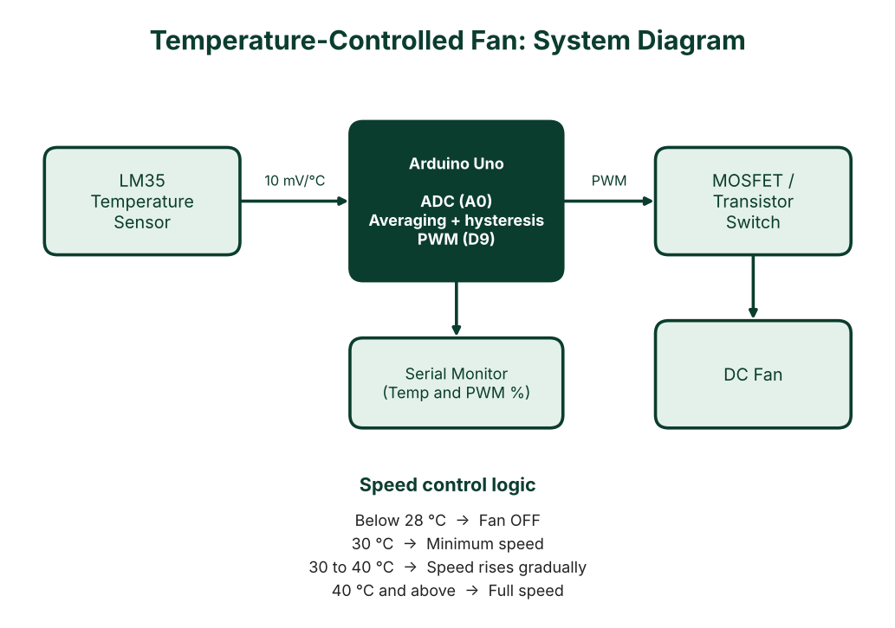

# Temperature-Controlled Fan Speed System (Arduino)

An Arduino-based system that measures room temperature and adjusts a DC fan's speed automatically using PWM. Built as a course project for **Electrical Drives** (6th semester, CSE, International Islamic University Chittagong).

## How it works

1. An **LM35** sensor outputs 10 mV per °C.
2. The Arduino averages 10 readings to reduce noise and converts them to °C.
3. Fan speed is set with PWM on pin 9, driving the fan through a MOSFET/transistor.
4. Temperature and fan speed are printed over Serial for monitoring.

| Temperature | Fan behaviour |
|---|---|
| Below 28 °C | Off |
| 30 °C | Starts at minimum speed (about 35% duty) |
| 30 – 40 °C | Speed rises gradually |
| 40 °C and above | Full speed |

The gap between 28 °C (off) and 30 °C (on) is **hysteresis**, which prevents the fan from rapidly switching on and off near the threshold.

## Components

> Edit this list so it matches the exact parts you used.

- Arduino Uno
- LM35 temperature sensor
- N-channel MOSFET (or NPN transistor) as the fan switch
- Flyback diode across the fan
- DC fan with a suitable external supply
- Breadboard and jumper wires

## Wiring

| Part | Arduino pin |
|---|---|
| LM35 output | A0 |
| LM35 VCC / GND | 5V / GND |
| MOSFET gate (via resistor) | D9 (PWM) |
| Fan supply and Arduino | Common ground |

## Run it

1. Open `temperature_fan_control.ino` in the Arduino IDE.
2. Select your board and port, then upload.
3. Open the Serial Monitor at **9600 baud** to see live readings.
4. Adjust `TEMP_ON`, `TEMP_OFF`, `TEMP_FULL` and `PWM_MIN` at the top of the file to suit your fan.

## What I learned

- Reading analog sensors and converting ADC values to physical units
- PWM speed control and driving loads safely with a MOSFET
- Noise reduction by averaging and avoiding flicker with hysteresis

## Possible improvements

- Add an LCD or OLED display for temperature and speed
- Use a DHT22 for humidity-aware control
- Log data to an SD card or send it over Bluetooth

## Team

- Mahbubullah (C193085)
- Team members from the same course group

## Course

Electrical Drives, International Islamic University Chittagong (IIUC)
